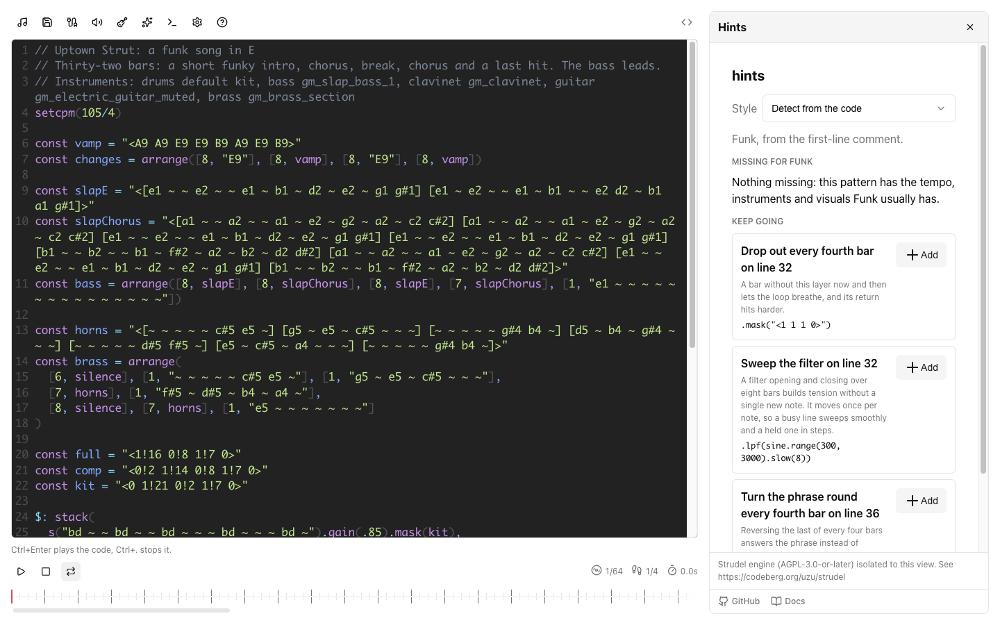

# Strudel Node Editor

Live-code music in the browser with [Strudel](https://strudel.cc) at
[strudel.cnotv.xyz](https://strudel.cnotv.xyz): a code editor, a node editor for instruments
and effects, a timeline, score and tab transcription, and WAV or MIDI export.



Embedding it in your own app is covered in the
[documentation](https://cnotv.github.io/strudel-node-editor/).

## Related sites

| Site                                       | Repository                                                        |
| ------------------------------------------ | ----------------------------------------------------------------- |
| [cnotv.xyz](https://cnotv.xyz)             | [cnotv/cnotv-portfolio](https://github.com/cnotv/cnotv-portfolio) |
| [games.cnotv.xyz](https://games.cnotv.xyz) | [cnotv/games-lobby](https://github.com/cnotv/games-lobby)         |
| [lab.cnotv.xyz](https://lab.cnotv.xyz)     | [cnotv/generative-art](https://github.com/cnotv/generative-art)   |

## Run it

```bash
pnpm install
```

```bash
pnpm dev --port 5317 --strictPort
```

Checks: `pnpm lint`, `pnpm lint:css`, `pnpm test:unit`, `pnpm type-check:netlify`,
`pnpm build`. Guides and the story of how the editor was built live in
[`documentation/`](documentation/docs) and are published at
[cnotv.github.io/strudel-node-editor](https://cnotv.github.io/strudel-node-editor/).
