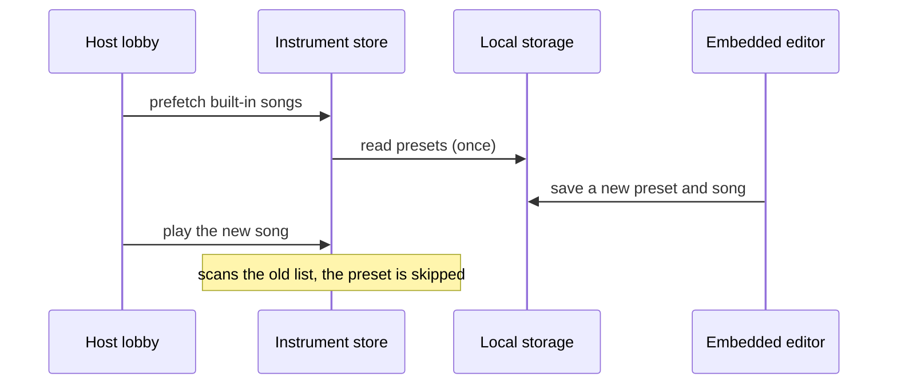

# Songs added later stay silent in a host app

A host app that loads the editor from npm, such as the Rhythm lobby in games-lobby, played the
built-in songs once the presets rendered without a Pinia (#36). A song added afterwards from the
editor embedded in the game still played silent.

## Cause

Playing or rendering code calls `prepareInstrumentsForCode`, which asks the instrument store for the
presets the code names. The store builds its preset list once, when it is created, by reading the
presets and tweaks saved in local storage. A host creates that store early, when the lobby prefetches
the built-in songs, and the embedded editor then saves a preset into storage. The list the store scans
was never read again, so the new preset's name matched nothing and it was never rendered before
the song played.

Built-in presets were never affected, which is why the existing songs kept working and the
list of songs itself was never stale: `STRUDEL_SONGS` is a constant and the saved songs are read from
storage on every call.

## Fix

`ensureRenderedForCode` now re-reads the stored presets and tweaks before it scans the code
(`reloadStored` in `presetLibrary.ts`). The selection is left alone, and the lists are replaced only
when the stored ones differ. The test creates a preset through a second store and expects the first
store to render it.

## Still the host's job

The host keeps its own copy of the saved songs and, in games-lobby, a cache of rendered notes per
song id. It must read the saved songs again when the editor closes, and drop the cached notes of a
song whose code changed.
